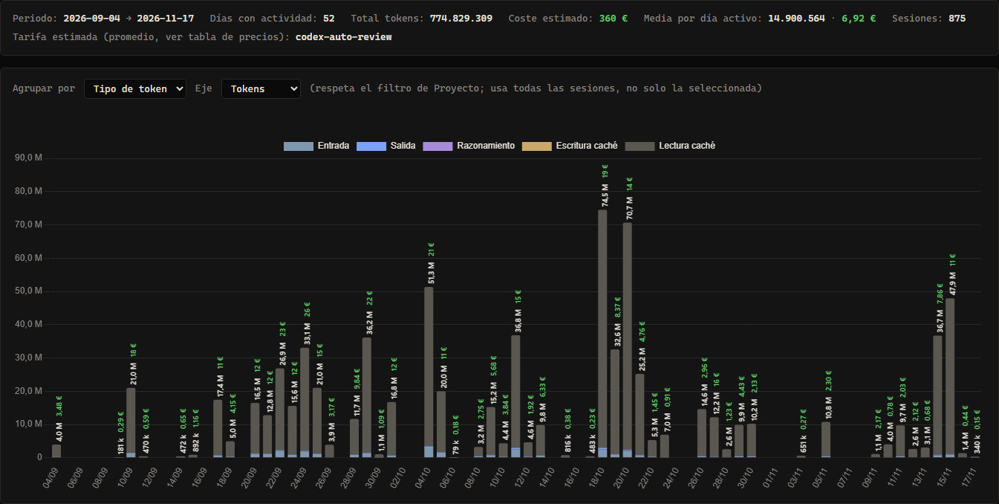

# Codex Monitor

Consumo de tokens de Codex por sesión, subagente y revisión automática, con tema oscuro estilo terminal.



Todo se calcula en el navegador a partir de los transcripts `.jsonl` de Codex (`~/.codex/sessions`). No hay backend ni dependencias que instalar (Chart.js va incluido en `vendor/`).

Versión hermana para Claude Code: [ClaudeMonitor](https://github.com/developez/ClaudeMonitor).

## Arranque rápido

Solo necesitas **Python 3**. Si no lo tienes, instálalo desde [python.org/downloads](https://www.python.org/downloads/). En Windows, marca la casilla **"Add python.exe to PATH"** durante la instalación.

1. Descarga el proyecto: botón verde **Code → Download ZIP** en GitHub, y descomprímelo donde quieras.
2. Arráncalo:
   - **Windows:** doble clic en `start.bat`.
   - **Linux / macOS:** abre una terminal en la carpeta y ejecuta `sh start.sh`.
3. Se abre el navegador en **http://localhost:8050/**. Si no se abre, escribe esa dirección a mano.

Para pararlo, cierra la ventana negra (Windows) o pulsa `Ctrl+C` en la terminal.

El script hace dos cosas: enlaza la carpeta de sesiones de Codex (`~/.codex/sessions`, o `$CODEX_HOME/sessions` si lo tienes definido) como `codex-sessions`, y sirve la carpeta en el puerto 8050. Solo se enlaza `sessions`, no el resto de `~/.codex`, donde están tus credenciales. El servidor solo escucha en tu equipo (`127.0.0.1`), así que nadie más de tu red puede verlo.

> ¿Usas también Claude Monitor? Los dos usan el puerto 8050, así que no pueden estar abiertos a la vez. Cambia `PORT=8050` en el `start` de uno de ellos.

## Configuración opcional

Por defecto se muestran todos los proyectos (la carpeta de trabajo de cada sesión). Para limitarlos o darles nombre, copia `config.example.json` a `config.json`:

```json
{
  "folders": ["C:/Projects/Acme"],
  "names": { "C:/Projects/Acme/web": "Acme · web" }
}
```

## Arranque manual

Si prefieres hacerlo tú:

```powershell
# Windows (PowerShell)
New-Item -ItemType Junction -Path codex-sessions -Target "$env:USERPROFILE\.codex\sessions"
python -m http.server 8050 --bind 127.0.0.1
```

```bash
# Linux / macOS
ln -s ~/.codex/sessions codex-sessions
python3 -m http.server 8050 --bind 127.0.0.1
```

Vale cualquier servidor estático que genere listados de directorio con el formato de `python -m http.server`. No sirvas `~/.codex` entero: ahí está `auth.json`.

## Qué muestra

- Tokens por sesión desglosados en entrada, salida, razonamiento, escritura de caché y lectura de caché.
- Una barra por la sesión principal, otra por cada subagente y otra por cada revisión automática de acciones (`codex-auto-review`), con modelo y número de peticiones.
- Pestaña **En el tiempo**: consumo por día, agrupado por tipo de token o por modelo, en tokens o en euros.
- Uso de tus **límites** (ventana de 5 horas y semanal), tal como los informa Codex en su último registro.
- Coste estimado en euros con las tarifas oficiales de la API de OpenAI. Es el equivalente de pago por uso, no lo que cobra tu plan.
- Tabla de **precios por modelo** al final de la página. Los modelos sin tarifa publicada, como `codex-auto-review`, usan una tarifa estimada: el promedio de los modelos con precio que aparecen en tus datos.
- Filtro por proyecto y sesión, y opción de ocultar la lectura de caché.

## Cómo se cuentan los tokens

Cada respuesta del modelo deja un registro `token_usage_record` en el transcript. Solo se suman los del propio hilo, porque los subagentes que nacen como *fork* copian el historial del padre, y contarlo otra vez duplicaría el consumo. Los subagentes y las revisiones se agrupan bajo su sesión principal mediante `session_id` y `parent_thread_id`.

Codex da la entrada con la caché incluida y la salida con el razonamiento incluido. El monitor las separa para que las partes sumen el total sin solaparse, y cobra cada una a su tarifa:

| Parte | Tarifa |
|---|---|
| Entrada sin caché | entrada |
| Lectura de caché | lectura de caché (en torno a un 10 % de la entrada) |
| Escritura de caché | escritura de caché |
| Salida y razonamiento | salida |

Por encima de 272.000 tokens de entrada se aplica la tarifa larga del modelo, petición a petición. El coste supone el nivel Standard: no contempla los niveles Priority o Flex.

**Comprobado el 2026-11-21** con 8.354 respuestas de 244 hilos: ninguna respuesta aparece en más de un fichero, y la suma por hilo coincide exactamente con el total que el propio Codex guarda (`thread_token_usage`).

## Privacidad

`codex-sessions` y `config.json` están en `.gitignore`: contienen tus conversaciones y rutas locales y no deben subirse.
